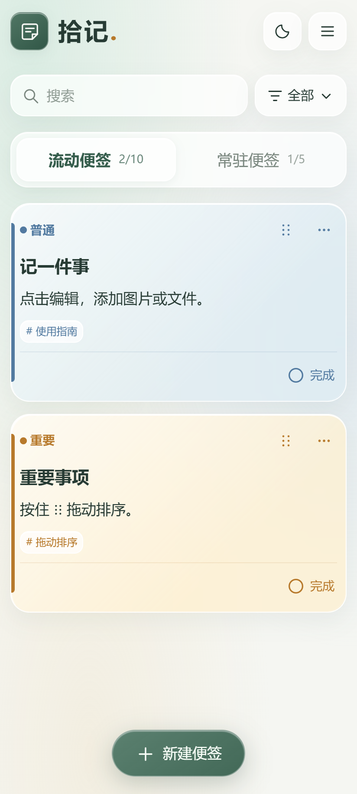
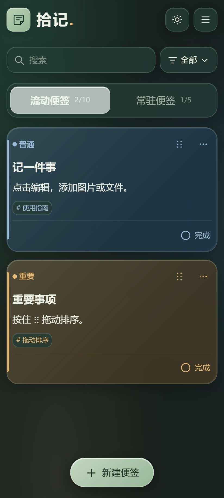

# 拾记 · Shiji Notes

一个离线 Android 便签应用，采用大字界面和液态玻璃风格。

## 下载安装

**[下载最新 APK（v1.3.1）](releases/shiji-1.3.1.apk?raw=true)**

支持 Android 8.0 及以上。下载到手机后打开安装。已有拾记用户可直接覆盖安装本仓库发布的 APK，保留便签。

## 功能

- 流动与常驻两个分页，最多 10 条和 5 条；拖动排序、一键置顶、跨页移动。
- 普通、重要、紧急三个等级，以蓝、橘、红区分。
- 完成后立即从当前页移走，进入归档盒，可撤销或恢复。
- 文字、图片和文件附件；单文件最多 20 MB，每条便签最多 8 个附件。
- 搜索、标签、截止日期、草稿恢复、分享文字。
- 回收站支持单条恢复、恢复全部，以及确认后删除全部。
- 完整备份与恢复，包含便签、图片、附件和主题设置。
- 亮色、暗色、跟随系统；适配状态栏、安全间距与键盘。

无需账号，数据保存在手机本地，APK 未申请联网权限。常驻分页为应用内固定栏。截止日期不会发送系统通知。

## 界面

| 亮色 | 暗色 |
| --- | --- |
|  |  |

[使用说明](docs/使用说明.md)

## 源码与构建

原生 Java 外壳 + 本地 WebView 页面。没有第三方应用运行依赖；无需联网加载页面。

```text
app/AndroidManifest.xml    Android 应用配置
app/src/                  原生文件、备份、系统栏和 WebView 实现
app/assets/               页面、交互逻辑和玻璃样式
app/res/                  图标与主题
build.ps1                 Windows 构建脚本
releases/                 最新安装包与 SHA-256 校验值
```

构建需要 JDK 17 或以上、Android SDK Platform 35 和 Build Tools 35.0.0。可使用 Android Studio 自带的 JDK。脚本支持下载包解压后的 SDK 目录，也支持常规 SDK 目录；请传入正确路径。

```powershell
$env:SHIJI_KEYSTORE_PASSWORD = '<自选的本地签名密码>'
./build.ps1 -JavaHome 'C:/Program Files/Android/Android Studio/jbr' -Sdk './sdk'
```

首次自行构建会生成 `local-signing.jks`，该文件及密码不会提交到仓库。请保留签名文件以便继续更新你自行构建的版本。自行生成的新签名不能直接覆盖仓库发布的 APK。

## 验证

27 项分页、完成、排序和回收站检查通过；Android 15 模拟器上 21 项原生检查通过，覆盖本地存储、文件附件、备份恢复、返回键、系统栏遮罩联动和安全间距。APK v2/v3 签名校验通过。尚未覆盖全部手机型号。

卸载或清除应用数据前请导出备份。
